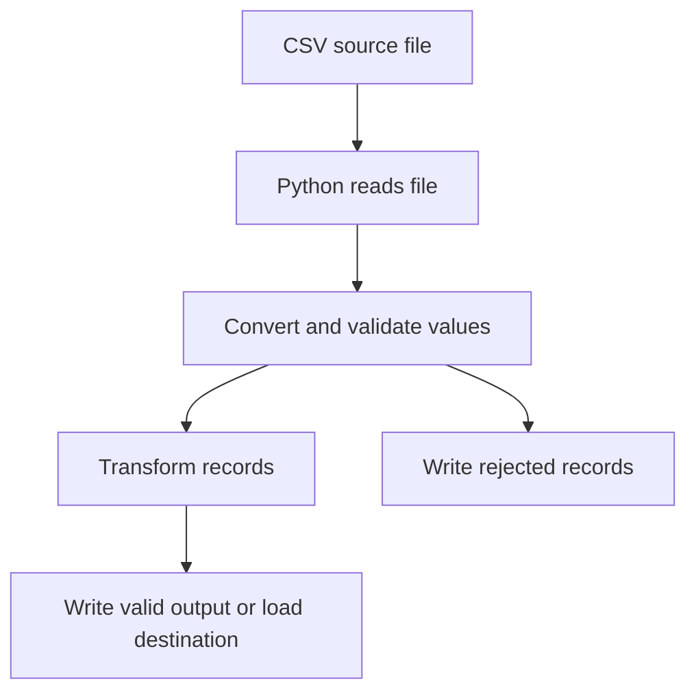

# Python File Handling and CSV Basics for Data Engineering

## 1. Why file handling matters

Data Engineering pipelines often read files, process records and write results. Python file handling is therefore a practical foundation for ETL.

## 2. Opening a file

```python
file = open("employees.txt", "r")
```

Common modes:

| Mode | Purpose |
|---|---|
| `r` | Read |
| `w` | Write; replaces existing content |
| `a` | Append to existing content |
| `x` | Create a new file; fails if it already exists |
| `b` | Binary mode modifier |
| `+` | Read and write modifier |

## 3. Reading files

Read all content:

```python
file = open("employees.txt", "r")
content = file.read()
file.close()
```

Read one line:

```python
file = open("employees.txt", "r")
line = file.readline()
file.close()
```

Read all lines into a list:

```python
file = open("employees.txt", "r")
lines = file.readlines()
file.close()
```

The difference:
- `read()` returns the content as one string.
- `readline()` returns one line.
- `readlines()` returns a list of lines.

## 4. Use `with open`

Preferred approach:

```python
with open("employees.txt", "r", encoding="utf-8") as file:
    content = file.read()
```

The file is automatically closed when the `with` block finishes, including when an exception occurs.

## 5. File pointer and seek

A file pointer tracks the current read/write position.

```python
with open("employees.txt", "r", encoding="utf-8") as file:
    first_part = file.read(10)
    file.seek(0)
    complete_content = file.read()
```

`seek(0)` moves the pointer to the beginning.

## 6. Write and append

Write (overwrites existing content):

```python
with open("output.txt", "w", encoding="utf-8") as file:
    file.write("ETL started\n")
```

Append (adds to the end):

```python
with open("output.txt", "a", encoding="utf-8") as file:
    file.write("ETL completed\n")
```

## 7. Split and type conversion

```python
line = "101,Ravi,45000"
parts = line.split(",")

employee_id = int(parts[0])
name = parts[1]
salary = int(parts[2])
```

`split(",")` separates a string at commas. For real CSV files, use Python's `csv` module because quoted values can contain commas and newlines.

## 8. Read CSV using csv.reader

```python
import csv

with open("employees.csv", "r", newline="", encoding="utf-8") as file:
    reader = csv.reader(file)
    for row in reader:
        print(row)
```

Each row is returned as a list.

## 9. Read CSV using DictReader

```python
import csv

with open("employees.csv", "r", newline="", encoding="utf-8") as file:
    reader = csv.DictReader(file)
    for row in reader:
        print(row["name"], row["salary"])
```

Each row is returned as a dictionary using the header names as keys.

## 10. Write CSV

```python
import csv

rows = [
    ["employee_id", "name", "salary"],
    [101, "Ravi", 45000],
    [102, "Anu", 40000]
]

with open("output.csv", "w", newline="", encoding="utf-8") as file:
    writer = csv.writer(file)
    writer.writerows(rows)
```

## 11. Exception handling

```python
try:
    with open("missing.txt", "r", encoding="utf-8") as file:
        content = file.read()
except FileNotFoundError:
    print("File does not exist")
except PermissionError:
    print("Permission denied")
```

Use specific exceptions where possible. Avoid hiding errors with a broad empty `except`.

## 12. How this fits ETL



## 13. Practice

1. Read a text file using `read()`.
2. Read the same file using `readline()`.
3. Read it using `readlines()`.
4. Use `seek(0)` to read it again.
5. Write a new file and append another line.
6. Read a CSV using `csv.reader`.
7. Read the same CSV using `csv.DictReader`.
8. Convert an ID and salary from strings to integers.
9. Handle a missing file using `try/except`.

## 14. Key takeaway

Use `with open` for safe file handling, use the `csv` module for real CSV files, convert text values to the required data types, and handle errors explicitly.
