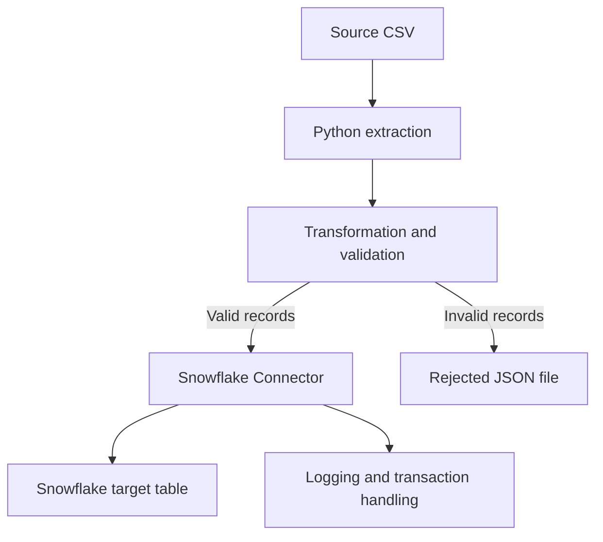

# Python + Snowflake Connector — Complete ETL Hands-On

## 1. Goal

Build a small ETL workflow using Python and Snowflake:

1. Extract records from CSV.
2. Transform and validate records.
3. Send invalid records to a rejected-records file.
4. Load valid records into Snowflake.
5. Use logging and exception handling.
6. Commit successful work and roll back failed transactions.

ETL means Extract, Transform, Load. It is a process, not a specific product.

## 2. Architecture



## 3. Example source CSV

`employees.csv`:

```csv
employee_id,name,department,salary
101,Ravi,IT,45000
102,Anu,HR,40000
103,John,Finance,50000
```

## 4. Install and connect

```bash
pip install snowflake-connector-python
```

Use environment variables or a secrets manager for credentials. Do not hard-code real passwords or commit secrets to Git.

```python
import os
import snowflake.connector

conn = snowflake.connector.connect(
    account=os.environ["SNOWFLAKE_ACCOUNT"],
    user=os.environ["SNOWFLAKE_USER"],
    password=os.environ["SNOWFLAKE_PASSWORD"],
    warehouse=os.environ["SNOWFLAKE_WAREHOUSE"],
    database=os.environ["SNOWFLAKE_DATABASE"],
    schema=os.environ["SNOWFLAKE_SCHEMA"]
)
```

## 5. Extract CSV records

```python
import csv

def extract_csv(file_path):
    with open(file_path, mode="r", newline="", encoding="utf-8") as file:
        reader = csv.DictReader(file)
        return list(reader)
```

`DictReader` reads each row as a dictionary using the header names as keys. CSV values are initially strings.

## 6. Transform and validate

```python
def transform_records(records):
    valid_records = []
    rejected_records = []

    for row in records:
        try:
            employee_id = int(row["employee_id"])
            salary = int(row["salary"])
            name = row["name"].strip()
            department = row["department"].strip()

            if employee_id <= 0 or salary < 0 or not name or not department:
                raise ValueError("Invalid employee data")

            valid_records.append(
                (employee_id, name, department, salary)
            )

        except (ValueError, KeyError, TypeError) as error:
            rejected_records.append({
                "record": row,
                "reason": str(error)
            })

    return valid_records, rejected_records
```

This separates valid rows from rejected rows instead of silently discarding invalid data.

## 7. Write rejected records to JSON

```python
import json

def save_rejected_records(rejected_records, output_path):
    with open(output_path, "w", encoding="utf-8") as file:
        json.dump(rejected_records, file, indent=4)
```

This creates an audit and reprocessing trail.

## 8. Create a Snowflake target table

```sql
CREATE TABLE IF NOT EXISTS EMPLOYEES (
    EMPLOYEE_ID NUMBER,
    NAME STRING,
    DEPARTMENT STRING,
    SALARY NUMBER
);
```

## 9. Load valid records with executemany

```python
def load_to_snowflake(conn, records):
    sql = """
        INSERT INTO EMPLOYEES
        (EMPLOYEE_ID, NAME, DEPARTMENT, SALARY)
        VALUES (%s, %s, %s, %s)
    """

    cursor = conn.cursor()
    try:
        cursor.executemany(sql, records)
        conn.commit()
    except Exception:
        conn.rollback()
        raise
    finally:
        cursor.close()
```

- `execute()` runs a statement for one parameter set.
- `executemany()` applies a parameterized statement to multiple parameter sets.
- `commit()` commits the transaction.
- `rollback()` reverts uncommitted transaction changes.

Use parameter binding rather than concatenating untrusted values into SQL.

## 10. Add logging and exception handling

```python
import logging

logging.basicConfig(
    filename="etl_pipeline.log",
    level=logging.INFO,
    format="%(asctime)s %(levelname)s %(message)s"
)

def run_pipeline():
    conn = None
    try:
        logging.info("ETL pipeline started")

        records = extract_csv("employees.csv")
        logging.info("Extracted %s records", len(records))

        valid_records, rejected_records = transform_records(records)
        logging.info("Valid: %s; rejected: %s",
                     len(valid_records), len(rejected_records))

        save_rejected_records(rejected_records, "rejected_records.json")

        conn = snowflake.connector.connect(
            account=os.environ["SNOWFLAKE_ACCOUNT"],
            user=os.environ["SNOWFLAKE_USER"],
            password=os.environ["SNOWFLAKE_PASSWORD"],
            warehouse=os.environ["SNOWFLAKE_WAREHOUSE"],
            database=os.environ["SNOWFLAKE_DATABASE"],
            schema=os.environ["SNOWFLAKE_SCHEMA"]
        )

        load_to_snowflake(conn, valid_records)
        logging.info("ETL pipeline completed successfully")

    except Exception:
        logging.exception("ETL pipeline failed")
        raise

    finally:
        if conn is not None:
            conn.close()
```

A production pipeline should also consider idempotency, batch sizing, retry policy, secure secret handling, data lineage and duplicate prevention when a job is rerun.

## 11. Overall workflow

```python
records = extract_csv("employees.csv")
valid_records, rejected_records = transform_records(records)
save_rejected_records(rejected_records, "rejected_records.json")

if valid_records:
    load_to_snowflake(conn, valid_records)
```

This is the conceptual flow. In a complete script, create the connection before loading and always close it in a `finally` block or context manager.

## 12. Concepts to remember

| Concept | Meaning |
|---|---|
| Extract | Read data from source |
| Transform | Clean, convert and validate data |
| Load | Insert valid data into destination |
| `csv.DictReader` | Reads CSV rows as dictionaries |
| `try/except` | Handles errors |
| `with open(...)` | Manages file closing |
| `execute()` | Executes SQL for a parameter set |
| `executemany()` | Executes parameterized SQL for multiple parameter sets |
| `commit()` | Commits transaction changes |
| `rollback()` | Reverts uncommitted changes |
| Logging | Records pipeline progress and failures |

## 13. Hands-on practice

1. Add a row with a non-numeric salary and verify it is rejected.
2. Add a row with a missing employee name.
3. Add a negative salary and confirm validation rejects it.
4. Load only valid rows.
5. Run the pipeline twice and observe duplicates. Design a business-key deduplication strategy.
6. Temporarily use an incorrect connection setting and inspect the logged error.
7. Verify the connection closes after success and failure.

## 14. Interview revision

- ETL is a process; Python is one tool that can implement it.
- `DictReader` maps CSV header names to row values.
- Validate and convert data before loading.
- Keep rejected records for diagnosis and reprocessing.
- Use parameterized SQL.
- `executemany()` is useful for multiple parameter sets.
- Commit after successful work; roll back on failure.
- Production pipelines need logging, retries, idempotency, monitoring and secure credential management.
